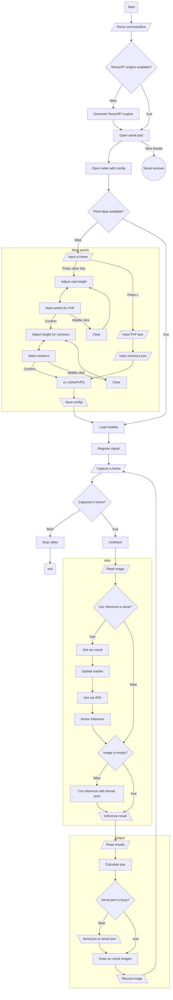

# Radar (station)
Detect robots by their cars and armors with monocular camera and YOLO  
Designed for and tested on Linux (Windows is disallowed in RoboMaster 2026)

## Flow:
Assume all functions are enabled

## System requirements:
* A device with NVIDIA GPU (inc. edge computing device)
* 4GB free RAM and VRAM
* Generic camera or GenICam-compatible camera (wide-angle lens‌ recommended)
* Linux
* C++17 compiler
* CMake
* Git & Git LFS

## Usage:
1. Clone this repository **(Make sure models are cloned too, or train your own model and convert to ONNX)**
2. Run `cmake -B build` to generate a *build* folder
3. Run `cmake --build build/ -j` to compile
4. Check executables and libraries in *build* folder
5. Use the calibration executable to generate camera config (`build/bin/calibration`)
6. Add more parameters by checking help output (`build/bin/radar --help`)
7. Set up camera and serial port (based on RoboMaster 2026 serial protocol V1.3.0)
8. Mark points on first startup (first contour for PnP and other contours for highlands)
9. Check result

>Remove config and redo step 7 and 8 when starting next game

## Bundled libraries: (Compiled along with main program)
* [TensorRT-YOLO](https://github.com/laugh12321/TensorRT-YOLO)
* [ByteTrack](https://github.com/ifzhang/ByteTrack)

## External libraries: (Use package manager to install them)
* [OpenCV](https://opencv.org/releases)
* [Eigen3](https://gitlab.com/libeigen/eigen)
* [CUDA & TensorRT (10.x)](https://developer.nvidia.com/cuda-downloads)
* [MVS](https://www.hikrobotics.com/cn/machinevision/service/download) (For HikCamera) or [MVviewer](https://www.1win.com.tw/support) (For other GenICam-compatible camera)

The ONNX files are built by [trtyolo](https://github.com/laugh12321/trtyolo-export) with plugins and dynamic batch

## Result:
In RoboMaster 2025, this program vulnerated opponents for 338.1s per game in average with 8mm lens  
In RoboMaster 2026, this program vulnerated opponents for 515.8s per game in average with 6mm lens  

## Special thanks:
Datasets provided by [Taurus](https://github.com/SCAU-RM-NAV/RM2023_Radar_Dataset)

## TODO:
* [ ] Train a better model with videos recorded
* [ ] Modify tracker's parameters to improve stability
* [ ] Adjust vulnerabilitiy's trigger
* [ ] ~~Cooperate with a LiDAR~~ (Radio should be enough)

## Note:
TCP interface provided for radio integration:  
Read rf_tx_frame for parameters  
Send demodulated RAW protocol data to upload positions and password
