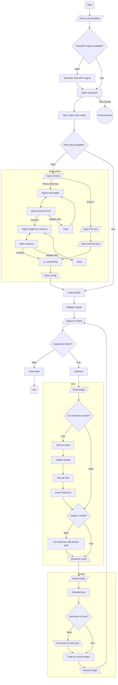

# Radar (station)
Detect robots by their cars and armors with monocular camera and YOLO  
Designed for and tested on Linux (Serial needs to be rewritten for Windows)

## Flow:
Assume all functions are enabled

## Usage:
1. Install a compiler that supports C++17 and dependencies below (plus **git** and **git-lfs** for cloning and **cmake** for building)
2. Clone this repository **(Make sure models are cloned too, or train your own model)**
3. Run `cmake -B build` to generate a *build* folder
4. Run `cmake --build build/ -j` to compile
5. Check executables and libraries in *build* folder
6. Use the calibration executable to generate camera config (`build/bin/calibration`)
7. Add more parameters by checking help output (`build/bin/radar --help`)
8. Set up camera and serial port (based on RoboMaster 2026 serial protocol V1.0.0)
9. Mark points on first startup (first contour for PnP and other contours for highlands)
10. Check result

## Bundled libraries: (Compiled along with main program)
* [TensorRT-YOLO](https://github.com/laugh12321/TensorRT-YOLO)
* [ByteTrack](https://github.com/ifzhang/ByteTrack)

## External libraries: (Use package manager to install them)
* [OpenCV](https://opencv.org/releases)
* [Eigen3](https://gitlab.com/libeigen/eigen)
* [CUDA & TensorRT](https://developer.nvidia.com/cuda-downloads)
* [MVS](https://www.hikrobotics.com/cn/machinevision/service/download) (For HikCamera)

The ONNX files are built by [trtyolo](https://github.com/laugh12321/TensorRT-YOLO/blob/main/docs/cn/model_export.md) with plugins and dynamic batch

## Result:
In RoboMaster 2025, this program vulnerated opponents for 338.1s per game in average

## Special thanks:
Datasets provided by [Taurus](https://github.com/SCAU-RM-NAV/RM2023_Radar_Dataset)

## TODO:
* [ ] Train a better model with videos recorded
* [ ] Modify tracker's parameters to improve stability
* [ ] Adjust vulnerabilitiy's trigger
* [ ] Cooperate with a LiDAR
* [ ] Behavior-based guess
* [ ] **NEW** Radio decrypt
